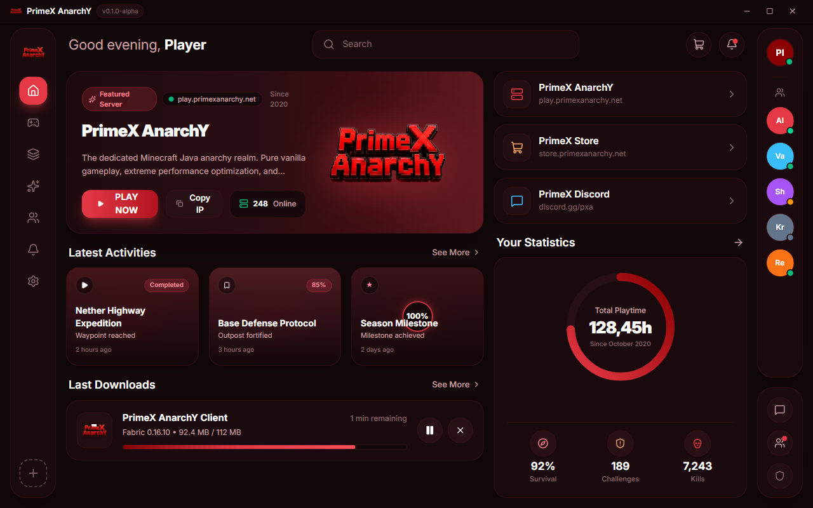



  

  # ⚡ PrimeX AnarchY Launcher

  <!-- Animated Typing Subtitle -->
  

    

  
  
  
  
  
  

    

  
  &nbsp;&nbsp;
  
  &nbsp;&nbsp;
  

    

  <!-- Animated Glowing Divider Bar -->
  

    

  

 

<!-- Animated Glowing Divider Bar -->

## 🚀 Overview

**PrimeX AnarchY Launcher** is the dedicated competitive Minecraft client and desktop launcher built exclusively for the **PrimeX AnarchY Network**. Powered by a native Rust/Tauri core and a modern glassmorphic interface, it delivers maximum FPS, seamless one-click server connections, built-in mod management, and advanced anti-cheat integrity.

 

<!-- Animated Glowing Divider Bar -->

## 💎 Features

* ⚡ **Dual-Engine Architecture:** Seamlessly switch between the battle-tested **Fabric Java Client** (with custom in-game HUD & server verification) and the cutting-edge **PrimE Rust Engine** (powered by Horizon) for instant cold starts.
* 🛡️ **Hardware Anti-Cheat & Whitelist Verification:** Built-in mod hash verification, server cryptographic challenges (`primex:verify`), and real-time ghost-client process scanning to maintain a competitive, fair-anarchy playing field.
* 🚀 **Potato PC JVM Memory Compaction:** Custom G1GC garbage collection tuning engineered to maintain smooth 144–240+ FPS even on 4 GB low-end hardware.
* 🎨 **Integrated PrimeX Client Mod:** Custom Lunar/Feather style in-game HUD, adaptive title screen with live server telemetry, FPS counter, CPS monitors, and cosmetics.
* 🌐 **Automatic Server Connection:** Instant one-click join straight into `play.primexanarchy.net`.
* 🔒 **Secure Multi-Layer Vault:** Authentic Microsoft OAuth2 device-code login and native offline anarchy player profiles with Windows Credential Manager and local vault persistence.
* 🔄 **Seamless Auto-Updates:** Never re-download manually again. The launcher verifies cryptographic Ed25519 signatures and automatically updates on startup or on demand.

 

<!-- Animated Glowing Divider Bar -->

## 📥 Downloads & Installation

| Package | Type | Description | Link |
| :--- | :--- | :--- | :--- |
| **PrimeX-Launcher-Setup.exe** | **Installer (Recommended)** | Full Windows NSIS setup. Creates desktop & Start Menu shortcuts. | [Download Setup](https://github.com/primeXbunny/primex-launcher-releases/releases/latest/download/PrimeX-Launcher-Setup.exe) |
| **PrimeX-Launcher.exe** | **Standalone / Portable** | Single `.exe` without installation. Drop anywhere and launch. | [Download Portable](https://github.com/primeXbunny/primex-launcher-releases/releases/latest/download/PrimeX-Launcher.exe) |
| **release-manifest.json** | **Manifest** | Cryptographically signed checksums for in-app auto-updates. | [View Manifest](https://github.com/primeXbunny/primex-launcher-releases/releases/latest/download/release-manifest.json) |

> [!TIP]
> **Windows SmartScreen Notice:** Since PrimeX Launcher is newly compiled software, Windows SmartScreen may show a *"Windows protected your PC"* popup on first launch. Click **"More info"** → **"Run anyway"**. All binaries are 100% open-source, compiled in public CI, and virus-free.

 

<!-- Animated Glowing Divider Bar -->

## 🐛 Bug Reports, Glitches & Issues

Found a bug? Encountered a crash? Have a feature request or design suggestion?

We actively track and resolve issues right here on GitHub!

### How to Report an Issue:
1. Head over to the **[Issues Tab](https://github.com/primeXbunny/primex-launcher-releases/issues)**.
2. Click **[New Issue](https://github.com/primeXbunny/primex-launcher-releases/issues/new)**.
3. Provide helpful details:
   - **What happened:** A short description of the issue.
   - **Steps to reproduce:** How can we trigger the bug?
   - **Screenshots / Logs:** Attach screenshots or copy error logs from `%APPDATA%\.primex-anarchy\logs`.
   - **Your Environment:** Windows 10/11, RAM amount, etc.

> [!NOTE]
> All issues submitted here are reviewed directly by **Lead Developer Bunny** and the PrimeX engineering team!

### 💬 Need Live Support?
Join our official Discord community at **[discord.gg/pxa](https://discord.gg/pxa)**:
* 🎧 **24/7 Support:** Instant help from moderators and players.
* 📢 **Announcements:** Be the first to know about launcher updates and server events.
* 🚀 **Direct Feedback:** Chat directly with **Lead Developer Bunny**!

 

<!-- Animated Glowing Divider Bar -->

## 👑 Team & Credits

* **Lead Developer:** **Bunny** ([@primeXbunny](https://github.com/primeXbunny))
* **Server Infrastructure:** PrimeX Anarchy Network
* **Website:** [primexanarchy.net](https://primexanarchy.net)
* **Store:** [store.primexanarchy.net](https://store.primexanarchy.net)
* **Discord Community:** [discord.gg/pxa](https://discord.gg/pxa) (**3,762 Members** · 89 Online · since 2020)

 

<!-- Animated Glowing Divider Bar -->

  Copyright © 2026 PrimeX AnarchY Network. Not an official Minecraft product. Not approved by or associated with Mojang or Microsoft.

